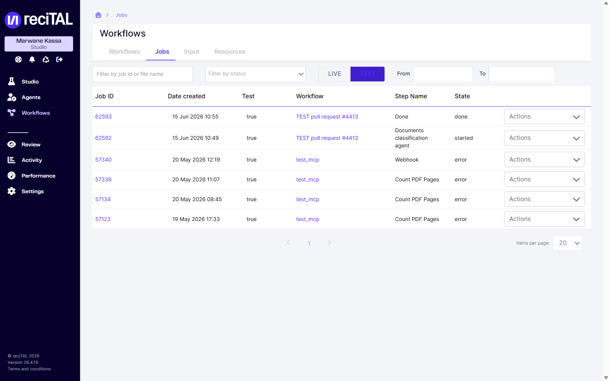
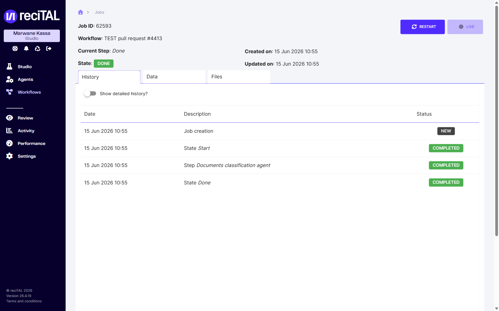
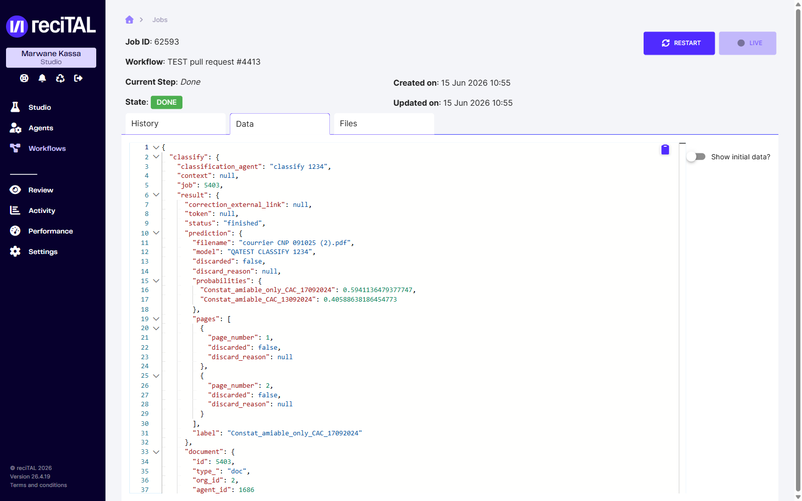
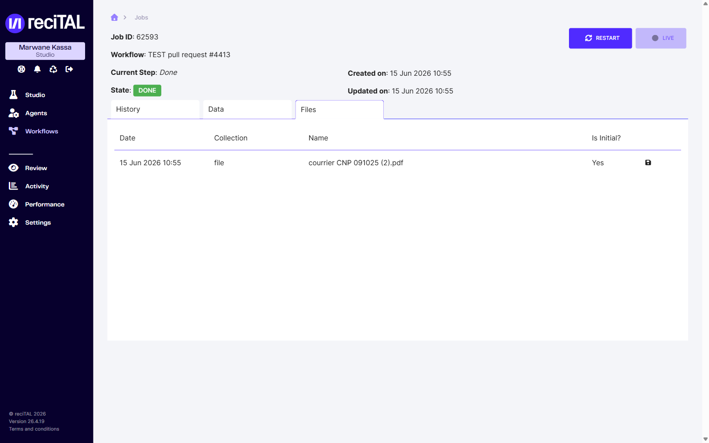

# Jobs

## Qu'est-ce qu'un Job ?

Un Job représente le parcours d'un document au travers du Workflow vers lequel il a été envoyé. Chaque module, état ou transition d'un Workflow est retranscrit dans les jobs.


Un job permet de :

* Suivre la progression d'un document.
* Identifier l'état d'un document : started, waiting, done, error, custom.
* Consulter les données à chaque étape du Workflow.
* Voir les logs à chaque étape du Workflow, et donc déboguer si besoin.
* Télécharger les documents originaux et les documents générés.


## Conservation et suppression des jobs

Les jobs de Workflow font l'objet d'une suppression automatique liée à leur durée de conservation (rétention). L'âge d'un job est calculé depuis sa **date de création**, et non depuis son passage à l'état **Done** ou en erreur.

Relancer un job avec **Restart** ne modifie pas sa date de création : la durée de conservation de ce job continue à courir depuis sa création initiale, et non depuis sa relance.

| Statut du job | Délai de conservation depuis la création |
| --- | --- |
| Terminé avec succès | 7 jours |
| En erreur | 14 jours |
| En cours | 14 jours |

La suppression devient applicable dès que le job atteint **le délai prévu pour son statut ou la limite globale de 14 jours, selon celui qui est atteint en premier**. Cette limite globale concerne tous les jobs, quel que soit leur statut, même ceux encore en cours : un délai plus long pour un statut ne repousse pas cette échéance.

La suppression est **asynchrone** : ces délais rendent le job éligible au nettoyage, sans garantir sa suppression à un instant précis.

Après suppression, le job et ses données ne sont plus consultables dans **Jobs** : historique des étapes, logs associés et fichiers originaux ou générés ne sont plus accessibles depuis ce job. Le nettoyage peut aussi viser les documents d'extraction ou de classification référencés dans les données du job. Cela ne constitue pas une garantie d'effacement de toutes les copies dans les autres services ou systèmes destinataires.

**Si vous devez conserver des résultats, téléchargez les fichiers et enregistrez les données utiles dès qu'ils sont disponibles**, sans attendre la fin de la durée de conservation. Ne comptez pas sur l'onglet **Jobs** comme archive durable.

Cette rétention des jobs ne doit pas être confondue avec les réglages de suppression des documents dans **Review**, de la **Corbeille** ou des **Datasets**. Le module [Nettoyer](modules/nettoyer.md) peut également supprimer des données ou fichiers au cours du Workflow, avant la suppression du job.

## Consulter les jobs

Depuis la page **Workflows**, ouvrez l'onglet **Jobs**. Si vous avez réussi à envoyer un premier document — que ce soit par API (voir [Envoyer des documents dans un Workflow](../integration-api/workflow/envoyer-des-documents-dans-un-workflow.md)) ou via l'upload d'un document pour tester le Workflow — vous devriez voir apparaître un premier job.

Le tableau liste pour chaque job son **ID**, sa **date de création**, s'il s'agit d'un **test**, le **Workflow** d'origine, l'**étape** en cours et son **état**. La bascule **Live / Test** sépare les jobs de production des jobs de test, et les filtres (statut, plage de dates, ID ou nom de fichier) permettent de retrouver un job précis.

<figure><figcaption>Onglet <em>Jobs</em> — tableau des jobs avec la bascule Live/Test et les filtres.</figcaption></figure>

Pour consulter les détails d'un job, cliquez sur son **ID**. L'en-tête rappelle l'ID, le Workflow, l'étape courante, l'état et les dates ; le bouton **Restart** permet de relancer le job.

### Historique

L'onglet **History** présente le déroulé étape par étape (création du job, états, étapes) avec leur statut. La bascule **Show detailed history?** affiche le détail, et l'on y retrouve les logs — utiles pour déboguer les paramètres d'un module ou un module custom (code Python).

<figure><figcaption>Jobs — onglet <em>History</em>.</figcaption></figure>

### Données

L'onglet **Data** affiche les données accumulées par le job (ajout successif des données à chaque étape), au format JSON. La bascule **Show initial data?** permet de comparer avec les données initiales.

<figure><figcaption>Jobs — onglet <em>Data</em>.</figcaption></figure>

### Fichiers

L'onglet **Files** recense tous les documents dans les différentes collections (avec la date, la collection, le nom et l'indication *Is Initial?*) et permet de les télécharger.


Le module **Cleanup** peut purger les données et les fichiers du job ; les options *Keep data / files / history / preliminary* déterminent ce qui est conservé (voir [Les modules de Workflow](les-modules-workflow.md)).


<figure><figcaption>Jobs — onglet <em>Files</em>.</figcaption></figure>
